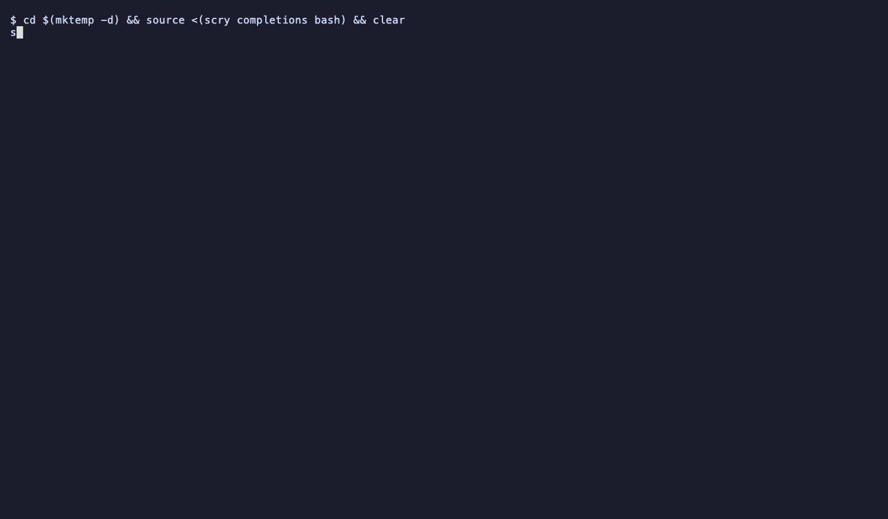

# scry

Preview what a change to a Nix fleet does to each machine.



**[Try it in your browser](https://zebradil.github.io/scry/demo/)**: the same viewer compiled to
WebAssembly, on a synthetic fleet, full screen.

For every selected NixOS, nix-darwin or home-manager configuration, scry finds the old and the
new toplevel and reports three sections:

- **Packages**: added, removed, upgraded, downgraded and resized packages, and the closure size.
  Rebuilds with the same version collapse into one line.
- **Files**: a line diff of every changed file under the followed trees (`etc`, launchd agents,
  home-manager files), with store-hash churn collapsed and changed store references followed.
- **Boot** (NixOS): kernel, initrd, modules, kernel parameters, specialisations.

Changes that appear identically in several configurations are shown once.

Two modes:

- **Deployed** (default): old is what each machine runs now, new is built from the working tree.
- **Revision** (`--base REV`): old is the same configuration built from git revision `REV`. No
  machine is contacted.

scry changes nothing on any machine: it copies no closure, adds no GC root and activates
nothing. The only write to a target is `colmena build` for nodes with `buildOnTarget`, which you
ask for by not passing `--no-build`.

Not covered: derivation-level diffs (`nix-diff`), a build plan, Markdown output, comparing two
sides on two different remote machines, and home-manager used as a NixOS or nix-darwin module.

## Install

```sh
nix profile install github:zebradil/scry
nix run github:zebradil/scry -- --help
```

Or as a flake input: `inputs.scry.url = "github:zebradil/scry";`, then
`inputs.scry.packages.${system}.default`. The package installs shell completions for bash, zsh
and fish.

CI builds the package for `x86_64-linux`, `aarch64-linux` and `aarch64-darwin` and pushes it to a
binary cache. Add it to skip the build:

```nix
nix.settings = {
  substituters = [ "https://znix.zebradil.dev" ];
  trusted-public-keys = [ "znix.zebradil.dev:nvr0OQFRddbHGopQbyLbLXQnntFBDKp23tqQq+msppw=" ];
};
```

Requirements:

- **Nix 2.13** on this machine when scry builds (`scry flake`, revision mode); 2.4 otherwise.
- **Nix 2.4** on targets. They also need `sh`, `find`, `ls`, `cksum` and `tar`; BSD tools work.
- `colmena` on `PATH` for `scry colmena`, `git` for `--base`, `ssh` for targets.

See [ADR 0061](docs/adr/0061-oldest-supported-nix.md) for how the Nix versions were established.

## Usage

```sh
# colmena: every node of the hive in the current directory, or a selection
scry colmena
scry colmena --on 'web-*,@db'          # globs on whole names, @tag for deployment.tags

# flake: the configurations of this machine (hostname, $USER@hostname, $USER)
scry flake
scry flake ~/src/fleet#web-a           # exactly one configuration
scry flake --on 'web-*' --target web-a=root@web-a.example

# revision mode: what the working tree changes compared to main, in every configuration
scry flake --base main
scry colmena --base origin/main --format json --exit-code

# two toplevels on one machine
scry paths /run/booted-system /run/current-system
scry paths --target root@web-a /nix/var/nix/profiles/system-41-link /run/current-system
```

- `--on SEL`: comma-separated patterns, each matching a whole name; `*` and `?` globs; `@tag`
  for colmena tags. A pattern that matches nothing is an error.
- `--no-build`: skip the build step; the toplevels must already be in the store.
- A flake configuration that is not this machine's is reached at its name (`[user@]host`, through
  `~/.ssh/config`) unless `--target NAME=TARGET` says otherwise.
- `--jobs`, `--eval-jobs`, `--timeout`, `--max-file-size`: see `scry <command> --help`.

## Output

- `--format auto` (default): the TUI when stdout is a terminal, text otherwise.
- `--format text`: plain text, configurations in name order, shared changes first.
- `--format json`: the full report.
- `--expand-churn` shows hash-only and version-only changes, which are collapsed by default.
- `--color auto|always|never`.
- `--word-highlight dim|background|reverse|underline|bold`: how changed words stand out inside a
  changed line, in text output and the TUI. `dim` (default) dims the rest of the line and keeps the
  changed words bold; `bold` alone is hard to see in some themes. `background` puts them on a red or
  green background.

TUI keys: `j`/`k` move, `J`/`K` next change, `h`/`l` and Enter fold, Tab switch pane, `1`–`9`
select a configuration, `/` filter, `w` wrap, `t` tree view, `y` copy the pane, `Y` copy the
configuration, `q` quit. The bottom line shows the hints.

## Exit codes

| Outcome | Default | `--exit-code` |
|---|---|---|
| No changes | 0 | 0 |
| Changes | 0 | 1 |
| A configuration failed (error, timeout, unfinished on quit) | 1 | 2 |
| Usage error | 2 | 2 |

## Environment

| Variable | Effect |
|---|---|
| `NIX_SSHOPTS` | Options for every `ssh` call, split as Nix splits them |
| `NO_COLOR` | Non-empty: no colour under `--color auto` |
| `SCRY_DEBUG` | Non-empty: log every command's argv and stderr to stderr |
| `USER` | Default selection and local targets of `scry flake` |
| `HOME`, `XDG_STATE_HOME` | Read on the old side's machine to find the home-manager profile |
| `SCRY_FIXTURE` | Non-empty: run against the synthetic fleet (below) |
| `COMPLETE` | Set by the completion scripts; do not export it |

## Shell completion

Installed by the package. Otherwise:

```sh
source <(scry completions bash)               # ~/.bashrc
source <(scry completions zsh)                # ~/.zshrc
scry completions fish | source                # ~/.config/fish/config.fish
```

Completes subcommands, flags and paths, configuration names after `scry flake REF#`, names and
`@tags` for `--on` (of the `REF` on the line), and branches and tags for `--base`. Errors, and
lookups slower than 3 s, complete nothing. The bash script needs no bash-completion package.

## Fixture mode

`SCRY_FIXTURE=1` replaces every external command with a synthetic fleet of five configurations:
one without changes, two with shared package, file and boot changes, one unreachable (absent at
base in revision mode) and one that fails to evaluate. No machine is contacted and nothing is
built. Works with every source flag, mode and output:

```sh
SCRY_FIXTURE=1 scry colmena
SCRY_FIXTURE=1 scry flake --on '*' --base main --format text
SCRY_FIXTURE=1 scry colmena --on <Tab>
```

The demo above is recorded in this mode from `docs/demo.tape`; `nix run .#demo` re-records it.

## Development

```sh
nix develop -c cargo test
nix fmt
nix build && nix flake check
```

Behaviour is specified in [`docs/spec.md`](docs/spec.md), structure in
[`docs/architecture.md`](docs/architecture.md), decisions in [`docs/adr/`](docs/adr/).

## License

Licensed under either of [Apache License, Version 2.0](LICENSE-APACHE) or [MIT license](LICENSE-MIT)
at your option.
